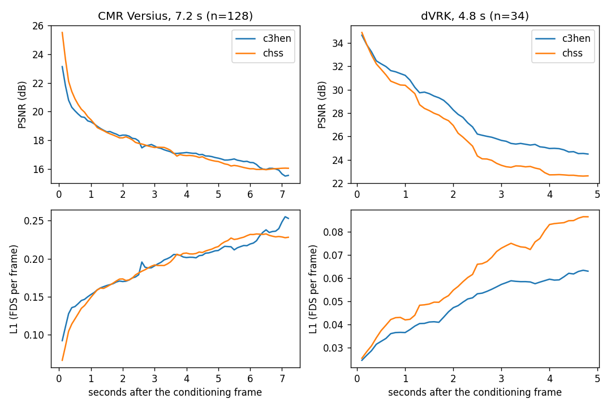

# Cosmos3-H-Embodied-Nano: Quantitative Evaluation

This document describes the quantitative evaluation of Cosmos3-H-Embodied-Nano:

- **Forward dynamics over long rollouts** (action-conditioned video prediction, chunk by chunk),
  implemented in [`scripts/quant_eval.py`](scripts/quant_eval.py);
- **All three modes on single clips** (forward dynamics, inverse dynamics, policy), with
  [`scripts/eval.py`](scripts/eval.py) ([below](#all-modes-on-held-out-clips));
- **A benchmark against [Cosmos-H-Surgical-Simulator](https://github.com/NVIDIA-Medtech/Cosmos-H-Surgical-Simulator)**,
  a forward-dynamics-only model, so it compares the one mode both models have, on episodes held
  out by both. The protocol and the metrics (FDS, GATC, TCD) follow that repository's
  [evaluation](https://github.com/NVIDIA-Medtech/Cosmos-H-Surgical-Simulator/blob/main/scripts/README_EVALUATION.md);
  the benchmark adds FID and FVD, and 31.2 s rollouts on CMR Versius.

## Overview

For each selected episode the script:

1. **Generates a video autoregressively** from a start frame of the episode (its first frame, or
   the first one with a valid sample window) and the recorded actions.
   Each chunk predicts 24 frames at 10 fps (2.4 s) and is conditioned on the last generated frame
   of the previous chunk. Through the dataset sample, the model also receives the 16 actions
   before the chunk (recorded, as in deployment, where the executed actions are known). The
   default of 3 chunks gives 72 generated frames (7.2 s), the horizon of Cosmos-H-Surgical-Simulator's
   evaluation (6 chunks of 12 frames).
2. **Scores the generated video against the recorded one** with four metrics, over all generated
   frames and per phase.
3. **Aggregates** the scores per dataset and overall (`summary.json`, `summary.md`).

Episodes come from the held-out split (`--dataset.dataset-split val`, the 5% of episodes per
dataset that training did not see), or from a plan file listing episodes and start frames.
The commands below use 35 sampling steps and guidance 6.0 (`--num-steps`, `--guidance`), as the
evaluation in the main README; each episode is rolled out with 2 seeds by default.

## Metrics

Frames are compared in \([-1, 1]\) (\(x \mapsto x / 127.5 - 1\)). The conditioning frame
(\(t = 0\)) is never scored. Let \(G_t\) and \(\hat{G}_t\) be the recorded and generated frames,
\(t = 1, \ldots, T\).

| Metric | Definition | Direction |
|---|---|---|
| **FDS** (Frame Decay Score) | Mean per-frame L1: \(\frac{1}{T} \sum_t \frac{1}{3HW} \sum_{i,j,c} \lvert \hat{G}_t - G_t \rvert\), as in Cosmos-H-Surgical-Simulator | Lower is better |
| **SSIM** | Mean per-frame SSIM (scikit-image, data range 2) | Higher is better |
| **PSNR** | \(20 \log_{10}(2 / \sqrt{\mathrm{MSE}})\), MSE over all generated frames | Higher is better |
| **Dynamic PSNR** | PSNR over the pixels whose recorded frame-to-frame change \(\lvert G_t - G_{t-1} \rvert\) (channel mean) is in the top 20% of the clip | Higher is better |

Dynamic PSNR is the PSNR of what moves: in endoscopic video most pixels are tissue that barely
changes, so PSNR alone rewards a model that copies the conditioning frame. The motion mask is
taken from the recorded video only (`cosmos_framework.inference.metrics.compute_dynamic_psnr`).

Each metric is also reported for three phases, the chunks of Cosmos-H-Surgical-Simulator's
evaluation:

| Phase | Frames | Time after the conditioning frame |
|---|---|---|
| Early | 1–12 | 0.1–1.2 s |
| Mid | 13–36 | 1.3–3.6 s |
| Late | 37–72 | 3.7–7.2 s |

### Tool metrics

The benchmark below also reports the two tool metrics of Cosmos-H-Surgical-Simulator,
computed by [`tools/benchmark/tool_metrics.py`](../tools/benchmark/tool_metrics.py) (a port of
its implementation). Both need a surgical tool segmenter:
[Medical-SAM3](https://github.com/AIM-Research-Lab/Medical-SAM3) fine-tuned on CholecSeg8k,
prompted with "surgical tool" (instances with score ≥ 0.3). It is trained on laparoscopic video,
so these metrics are reported for CMR Versius only, not for the dVRK datasets.

| Metric | Definition | Direction |
|---|---|---|
| **GATC** (GT-Anchored Tool Consistency) | Per frame: zero-normalized cross-correlation of the grayscale recorded and generated frames inside the recorded tool mask (dilated by 10 px), maximized over shifts of ±3 px and ±1 frame, times a tool-presence factor (generated / recorded gradient energy in the mask, at most 1). Median over the frames with a tool. In [-1, 1] | Higher is better |
| **TCD** (Tool Centroid Distance) | Per frame: centroids of the tool instances in the recorded and generated frames, matched by the Hungarian algorithm; a recorded tool without a match costs half the image diagonal. Median over the frames with a tool, in pixels | Lower is better |

TCD mixes two errors: tools that are misplaced and tools that the segmenter does not find in
the generated frame. `tool_metrics.py` also reports them separately (mean distance of the matched
tools, share of recorded tools left unmatched).

### Realism metrics

FID and FVD compare the distribution of generated frames or clips with that of the recorded ones,
not each prediction with its own recording; they are computed by
[`tools/benchmark/realism_metrics.py`](../tools/benchmark/realism_metrics.py) on the frames the
benchmark scores (conditioning frame excluded).

| Metric | Definition | Direction |
|---|---|---|
| **FID** (Fréchet Inception Distance) | Fréchet distance between Gaussians fitted to the Inception-v3 pool features (TensorFlow FID weights, via `torch-fidelity`) of single generated and recorded frames | Lower is better |
| **FVD** (Fréchet Video Distance) | The same with I3D (Kinetics-400) features of 16-frame clips taken every 8 frames, resized to 224×224 | Lower is better |
| **Sharpness ratio** | Mean Sobel gradient energy of the generated frames / that of the recorded frames | 1 is ideal; below 1: blurrier |
| **Motion ratio** | Mean frame-to-frame change \(\lvert \hat{G}_t - \hat{G}_{t-1} \rvert\) of the generated video / that of the recorded video | 1 is ideal |

FID and FVD depend on the number of samples, so models are only compared on the same rollouts.
The confidence intervals come from a paired bootstrap over clips (200 resamples). FID measures
how realistic single frames look; FVD also measures motion.

## Usage

```bash
export OPENH_DATA_ROOT=/path/to/prepared/data   # see tools/data_prep/README.md
python -m cosmos3_h_embodied.scripts.quant_eval --no-guardrails \
    --checkpoint-path <dcp dir> --config-file cosmos3_h_embodied/configs/config.py \
    --experiment openh_h16_task_prompt --dataset.dataset dvrk_hamlyn \
    --episodes-per-root 3 --num-seeds 2 --seed 0 --num-steps 35 --guidance 6.0 -o outputs/quant_eval
```

One family per run (`--dataset.dataset`), one GPU per process. To spread rollouts over GPUs,
start one process per GPU with `--num-shards N --shard-index i` and the same output directory,
then aggregate with `--summarize-only -o <dir>`.

| Argument | Default | Description |
|---|---|---|
| `--dataset.dataset` | | Family (see `configs/openh_datasets.py`) |
| `--dataset.dataset-split` | `val` | `val`: held-out episodes; `full`: all (use with `--plan`) |
| `--num-chunks` | 3 | 24-frame chunks per rollout |
| `--episodes-per-root` | 3 | Episodes per dataset root (the first long enough ones of the split) |
| `--num-seeds` | 2 | Rollouts per episode (seed `--seed + 1000 * i`, `+ k` for chunk `k`) |
| `--plan` | | JSON list of `{"root", "episode", "start_frame"[, "num_frames"]}` instead of the automatic selection |
| `--num-shards`, `--shard-index` | 1, 0 | Run every `num-shards`-th rollout |
| `--save-videos` | on | Side-by-side MP4 (recorded \| generated) per rollout |
| `--save-inputs` | off | The rollout's model inputs (`inputs.npz`), which [`scripts/simulate.py`](scripts/simulate.py) replays |
| `--summarize-only` | off | Only aggregate the rollouts in `-o` |

Per rollout, the output directory `<family>/<root>/ep<episode>_f<start>_s<seed>/` holds
`rollout.npz` (recorded and generated frames, uint8, the content region without padding),
`rollout.json` (episode, source frames, seed), `metrics.json` and `comparison.mp4`.

Held-out episodes: the `val` split is a seeded random 5% of the episodes of each dataset root, as
in training. It depends on the number of episodes in the root, so it matches the training split
only on the data the checkpoint was trained on (see [`training_differences.md`](training_differences.md)
for the roots that differ from the Hugging Face dataset).

## All modes on held-out clips

[`scripts/eval.py`](scripts/eval.py) runs each mode on single 2.4 s clips (25 frames, 24 actions) and
scores it against the recording: forward dynamics (video from the first frame and the recorded
actions), inverse dynamics (actions from the recorded video) and policy (actions and video from the
first frame, the prompt and the action history).

- **Clips**: 64 per family, evenly spaced over its `val` split (`--spread-samples`), for the 10
  public families with held-out episodes (`dvrk_rob_surgical` has none).
- **Metrics**: PSNR of the generated clip (all 25 frames, the conditioning frame included);
  action MSE over the 24 predicted rows in normalized action space (each dimension mapped to
  [-1, 1] by the family's 1st/99th percentiles).
- **Policy, 4 rollouts per clip** (seeds 0–3), since its output is multimodal (the Cosmos 3 paper
  reports policy mode over 4 rollouts for the same reason): the mean, and the best of 4 (lowest MSE,
  highest PSNR, per clip).
- **Baseline**: predicting the mean recorded chunk of the family's 64 clips for every clip (its
  MSE is the variance of the actions). It is taken from the evaluated clips themselves, so it is
  an optimistic constant predictor.
- One seed for forward and inverse dynamics; 35 steps, guidance 6.0.

| Family | Val episodes | FD PSNR ↑ | ID MSE ↓ | Policy MSE ↓ mean / best of 4 | Policy PSNR ↑ mean / best of 4 | Baseline MSE |
|---|---:|---:|---:|---:|---:|---:|
| cmr_clinical | 240 | 18.56 | 0.0187 | 0.1013 / 0.0564 | 16.66 / 17.78 | 0.0913 |
| dvrk_hamlyn | 2 | 28.68 | 0.0095 | 0.0520 / 0.0353 | 23.92 / 25.09 | 0.0998 |
| dvrk_jhu | 11 | 24.46 | 0.0176 | 0.0874 / 0.0544 | 21.56 / 22.38 | 0.0986 |
| dvrk_obuda | 16 | 29.91 | 0.0057 | 0.0503 / 0.0301 | 27.56 / 28.19 | 0.0989 |
| dvrk_smarts | 29 | 21.73 | 0.0112 | 0.0721 / 0.0532 | 18.95 / 19.59 | 0.0831 |
| dvrk_stanford | 29 | 30.78 | 0.0097 | 0.0486 / 0.0308 | 26.61 / 27.54 | 0.1060 |
| dvrk_tud_grasping_retraction | 7 | 25.53 | 0.0045 | 0.0246 / 0.0187 | 25.79 / 26.09 | 0.0261 |
| dvrk_ucberkeley | 29 | 31.20 | 0.0019 | 0.0127 / 0.0072 | 24.50 / 25.95 | 0.0528 |
| dvrk_ucsd | 10 | 25.27 | 0.0058 | 0.0219 / 0.0157 | 24.44 / 25.18 | 0.0393 |
| turin_mitic | 24 | 24.76 | 0.0022 | 0.0467 / 0.0294 | 20.03 / 21.02 | 0.0512 |
| **All (640 clips)** | | **26.09** | **0.0087** | **0.0518 / 0.0331** | **23.00 / 23.88** | **0.0747** |

- **Inverse dynamics** is 8.6× below the baseline (0.0087 vs 0.0747), and below it on every family,
  although it got only 20% of the training samples (forward dynamics and policy 40% each).
- **Policy**: the mean of 4 rollouts is 31% below the baseline, the best of 4 56%. The mean is
  above the baseline on CMR Versius (0.101 vs 0.091) and about equal on TUD (0.025 vs 0.026); the
  best of 4 is below it on every family.
- **Action following**: the video generated with the recorded actions (forward dynamics) is
  3.1 dB closer to the recording than the video generated with the policy's own actions, on 9 of
  10 families, consistent with the video following the actions it is conditioned on.
- MSE in this normalized space is not comparable across papers or action representations.

```bash
for s in 0 1 2 3; do                               # seed 0: all modes; seeds 1-3: policy only
  mode=wam; [ $s = 0 ] && mode=joint
  python -m cosmos3_h_embodied.scripts.eval --no-guardrails --checkpoint-path <dcp dir> \
      --config-file cosmos3_h_embodied/configs/config.py --experiment openh_h16_task_prompt \
      --dataset.dataset dvrk_hamlyn --dataset.model-mode $mode --dataset.dataset-split val \
      --dataset.num-samples 64 --spread-samples --seed $((20260908 + s)) --num-steps 35 --guidance 6.0 \
      -o outputs/all_modes/seed$s/dvrk_hamlyn
done                                               # repeat for each family
python tools/benchmark/summarize_eval.py --runs outputs/all_modes/seed{0,1,2,3} -o outputs/all_modes/summary
```

Results: [`tools/benchmark/results/all_modes/`](../tools/benchmark/results/all_modes/).

---

## Benchmark: Cosmos-H-Surgical-Simulator

Both models are rolled out from the same frames with the same recorded actions, and scored
against the same recorded frames.

### Protocol

| | Cosmos3-H-Embodied-Nano | Cosmos-H-Surgical-Simulator |
|---|---|---|
| Checkpoint | `c3-h-e-n_model_bf16.safetensors` (Hugging Face release) | `iter_000012000-v2/model_ema_bf16.safetensors` (Hugging Face release) |
| Base model | Cosmos3-Nano (16B) | Cosmos-Predict2.5 (2B) |
| Inference | [`quant_eval.py`](scripts/quant_eval.py): 24-frame chunks, 16-action history, 35 steps, guidance 6.0 | [`chss_rollout.py`](../tools/benchmark/chss_rollout.py) (its `inference_open_h.py` loop): 12-frame chunks, guidance 0 |
| Resolution | 256 tier: 320×176 for 16:9 video | 512×288 (2.6× the pixels) |
| Frame rate | 10 fps | 10 fps (per-embodiment frame interval) |

- **Episodes held out by both models**: in the 5% validation split of this model's training
  data and in the trailing 5% test split of Cosmos-H-Surgical-Simulator (episodes entirely in
  it). These sets barely overlap (one is random, the other the last episodes), which limits the
  benchmark to the episodes below.
- **Same start, same frames**: each rollout starts at the episode's first frame valid for both
  models' sample filters (usually frame 0) and predicts the same source frames.
- **Horizon**: CMR Versius 7.2 s (72 frames, Cosmos-H-Surgical-Simulator's evaluation horizon);
  dVRK 4.8 s (48 frames), since many held-out dVRK episodes are shorter than 7.2 s (17 usable
  episodes instead of 9).
- **Datasets**: all held-out-by-both episodes of the 4 CMR Versius procedures (64), and of the
  dVRK datasets on which both models were trained and for which Cosmos-H-Surgical-Simulator's
  normalization statistics are published (17: Hamlyn, Stanford, UCSD, UC Berkeley, Turin). JHU
  datasets are excluded: the Hugging Face dataset does not include Cosmos-H-Surgical-Simulator's
  statistics for them. The episode list is [`tools/benchmark/chss_benchmark_plan.json`](../tools/benchmark/chss_benchmark_plan.json).
- **2 seeds per episode**: 128 CMR and 34 dVRK rollouts per model.
- **Scoring** ([`compare_rollouts.py`](../tools/benchmark/compare_rollouts.py)): the reference
  frames are decoded from the Open-H Hugging Face videos, cropped to the part of the source frame
  both models generate and resized to 176 rows (antialiased bilinear), this model's output height;
  each prediction is cropped and resized the same way, so Cosmos-H-Surgical-Simulator's output is
  downscaled. Paired differences over rollouts: mean with 95% confidence interval, win rate, and
  Wilcoxon signed-rank p-value. The same scoring at 256 rows is a sensitivity check (below).

### Results

| Domain | Rollouts | Model | FDS ↓ | SSIM ↑ | PSNR ↑ | Dynamic PSNR ↑ |
|---|---:|---|---:|---:|---:|---:|
| dVRK, 4.8 s | 34 | **Cosmos3-H-Embodied-Nano** | **0.0490** | **0.818** | **26.53** | **21.08** |
| | | Cosmos-H-Surgical-Simulator | 0.0614 | 0.784 | 24.52 | 19.33 |
| CMR Versius, 7.2 s | 128 | Cosmos3-H-Embodied-Nano | 0.1927 | 0.369 | 17.17 | 14.91 |
| | | Cosmos-H-Surgical-Simulator | 0.1911 | 0.377 | 17.14 | 14.85 |

Paired differences (Cosmos3-H-Embodied-Nano − Cosmos-H-Surgical-Simulator; win rate: share of
rollouts in which Cosmos3-H-Embodied-Nano is better):

| Domain | Metric | Difference (95% CI) | Win rate | p |
|---|---|---:|---:|---:|
| dVRK | Dynamic PSNR | **+1.75 dB** (±0.60) | 88% | 1e-7 |
| | PSNR | **+2.01 dB** (±0.66) | 88% | 2e-7 |
| | SSIM | **+0.034** (±0.009) | 85% | 2e-8 |
| | FDS | **−0.0124** (±0.0030) | 88% | 1e-8 |
| CMR Versius | Dynamic PSNR | +0.06 dB (±0.16) | 51% | 0.58 |
| | PSNR | +0.02 dB (±0.21) | 52% | 0.83 |
| | SSIM | −0.008 (±0.008) | 40% | 0.03 |
| | FDS | +0.0016 (±0.0049) | 51% | 0.47 |



- **dVRK**: Cosmos3-H-Embodied-Nano is better on every metric and in 85–88% of the rollouts, and
  the gap grows with the horizon (PSNR +0.7 dB in the first 1.2 s, +2.0 dB at 1.3–3.6 s). It is
  ahead on 8 of the 9 datasets in dynamic PSNR (behind on Hamlyn needle grasp and handover, 1 episode).
- **CMR Versius**: on par in PSNR, dynamic PSNR and FDS. Cosmos-H-Surgical-Simulator has a small
  SSIM advantage (−0.008, p = 0.03) that comes from the first second (SSIM 0.544 vs 0.488, PSNR
  20.42 vs 19.90 dB at 0.1–1.2 s); Cosmos3-H-Embodied-Nano is slightly ahead after 3.7 s (PSNR
  16.36 vs 16.24 dB). CMR Versius was 50% of Cosmos-H-Surgical-Simulator's training compute, at a
  higher resolution; for this model it was 20% of the sampling ratio and 4 of 32 ranks (see
  [`README_ACTION_SPACE.md`](README_ACTION_SPACE.md)).
- **Robustness check**: Cosmos3-H-Embodied-Nano's own input for CMR is letterboxed to 832×480
  before resizing, so its input frames agree with the reference at 34.9 dB (median PSNR),
  Cosmos-H-Surgical-Simulator's at 40.9 dB. Scored against each model's own input frames instead,
  the CMR Versius differences are not significant either (SSIM −0.005, p = 0.19; PSNR +0.07 dB;
  dynamic PSNR +0.07 dB). On dVRK they are about the same as above (dynamic PSNR +1.68 dB).
- **Limits**: 17 dVRK episodes on 9 datasets (1–5 per dataset); the CMR episodes are the last
  episode indices of each procedure (Cosmos-H-Surgical-Simulator's test split). Inference settings
  are each model's released defaults, not tuned on these episodes.

Per-dataset tables and the robustness check are in [`tools/benchmark/results/results.md`](../tools/benchmark/results/results.md);
per-rollout scores in `results.json`.

### Tool metrics (CMR Versius)

The same 128 CMR Versius rollouts per model, at 176 rows (TCD in pixels at that size):

| Model | GATC ↑ | TCD px ↓ (median of rollouts) | Matched tools: distance px | Recorded tools missed | Tools per frame |
|---|---:|---:|---:|---:|---:|
| Recorded video | | | | | 2.20 |
| **Cosmos3-H-Embodied-Nano** | **0.488** | 74.1 (65.5) | 29.9 | 31% | 1.89 |
| Cosmos-H-Surgical-Simulator | 0.441 | **66.4 (56.8)** | 28.2 | 27% | 2.01 |

| Metric | Difference (95% CI) | Win rate | p |
|---|---:|---:|---:|
| GATC | **+0.047** (±0.022) | 65% | 8e-5 |
| TCD | +7.7 px (±7.9) | 33% | 0.006 |

- **GATC**: Cosmos3-H-Embodied-Nano is significantly better: its tools look more like the
  recorded tools at the recorded positions. It is ahead on all four procedures (significantly on
  cholecystectomy, hysterectomy and inguinal hernia) and from 1.3 s on (mid 0.529 vs 0.487, late
  0.398 vs 0.360); in the first 1.2 s the two are equal (0.660 vs 0.661).
- **TCD**: Cosmos-H-Surgical-Simulator is significantly better (median 56.8 vs 65.5 px). The
  difference comes from tools the segmenter does not find in the generated frames (31% vs 27% of
  the recorded tools missed): the tools found are placed about equally well (30 vs 28 px).
  Cosmos3-H-Embodied-Nano has the lower TCD on inguinal hernia (−17 px, not significant).
- **Resolution control**: each model's own input frames (the recorded video at the model's
  resolution), scored as if they were its prediction, give GATC 0.974 for Cosmos3-H-Embodied-Nano
  and 0.962 for Cosmos-H-Surgical-Simulator, TCD medians of 0.7 and 0.3 px and 8% vs 5% missed
  tools. At this height the resolution explains neither difference.
- **Limits**: both metrics depend on the segmenter. On the input frames it already misses 5–8%
  of the tools, and TCD has outliers (hysterectomy input frames: mean 12 px, median 1 px).

Per-procedure tables, phases and the resolution control: [`tools/benchmark/results/tool_metrics.md`](../tools/benchmark/results/tool_metrics.md);
per-rollout scores in `tool_metrics.json`.

### Realism: FID and FVD

The same rollouts at 176 rows. The input rows score each model's own input frames: the best value
reachable at that model's resolution.

| Domain | Metric | Cosmos3-H-Embodied-Nano | Cosmos-H-Surgical-Simulator | Difference (95% CI) | Input: C3HEN / CHSS |
|---|---|---:|---:|---:|---:|
| CMR Versius, 7.2 s | FID ↓ | **44.3** | 55.4 | **−11.0** (−13.6, −7.0) | 9.7 / 1.6 |
| | FVD ↓ | 274 | **225** | **+50** (+24, +112) | 15 / 4.5 |
| dVRK, 4.8 s | FID ↓ | 43.9 | 44.5 | −0.6 (−6.7, +4.8) | 5.1 / 3.1 |
| | FVD ↓ | 173 | 191 | −18 (−78, +35) | 11 / 4.4 |

- **CMR Versius**: the two metrics disagree. Single generated frames of Cosmos3-H-Embodied-Nano
  are closer to the recorded ones (FID −11.0, better in every bootstrap resample), while the
  motion of Cosmos-H-Surgical-Simulator's clips is (FVD +50 for Cosmos3-H-Embodied-Nano, worse in
  every resample). The FVD gap is not caused by the chunk boundaries of this model (it is the
  same for clips inside a 24-frame chunk) and grows with time. Both models' frames are less
  sharp than the recording, Cosmos3-H-Embodied-Nano's less so (gradient energy 0.92 vs 0.88 of
  the recorded video); Cosmos-H-Surgical-Simulator moves less than the recording (frame-to-frame
  change 0.87), and Cosmos3-H-Embodied-Nano about as much (1.02), with more change at
  chunk transitions and towards the end of the rollout.
- **dVRK**: on par (neither difference is significant; 17 episodes).
- **Resolution control**: the input frames score far below the generated ones, so the
  resolution does not explain the differences.

Tables: [`tools/benchmark/results/realism.md`](../tools/benchmark/results/realism.md).

### Long rollouts: 31.2 s on CMR Versius

22 of the CMR Versius episodes above that are long enough, 2 seeds each (44 rollouts per model),
rolled out for 312 frames (13 chunks of this model, 26 of Cosmos-H-Surgical-Simulator), scored at
176 rows in 6 s windows ([`chss_benchmark_plan_long.json`](../tools/benchmark/chss_benchmark_plan_long.json)).
Each cell: Cosmos3-H-Embodied-Nano / Cosmos-H-Surgical-Simulator.

| Window | FID ↓ | FVD ↓ | PSNR ↑ | Sharpness ratio | Motion ratio | GATC ↑ | TCD px ↓ |
|---|---:|---:|---:|---:|---:|---:|---:|
| 0–6 s | **64** / 71 | 501 / **428** | 16.71 / 16.76 | 0.93 / 0.86 | 0.94 / 0.81 | 0.488 / 0.429 | 77 / 58 |
| 6–12 s | 125 / 112 | 1103 / **648** | 14.40 / 14.73 | 0.74 / 0.81 | 1.22 / 0.87 | 0.257 / 0.276 | 102 / 79 |
| 12–18 s | 155 / **128** | 1234 / **655** | 14.30 / 14.05 | 0.66 / 0.78 | 0.79 / 1.00 | 0.212 / 0.217 | 124 / 101 |
| 18–24 s | 197 / **150** | 1550 / **876** | 13.85 / 13.55 | 0.62 / 0.76 | 0.80 / 0.98 | 0.189 / 0.201 | 129 / 116 |
| 24–31 s | 218 / **159** | 1765 / **961** | 13.24 / 13.12 | 0.59 / 0.75 | 1.36 / 1.10 | 0.149 / 0.164 | 151 / 124 |

Bold: better in at least 95% of the bootstrap resamples (FID, FVD).


- **Up to about 6 s** the two models are on par, as in the 7.2 s benchmark (FID better for this
  model, FVD for Cosmos-H-Surgical-Simulator).
- **After that, Cosmos-H-Surgical-Simulator degrades more slowly.** This model's frames get
  steadily blurrier (sharpness 0.59 of the recording at 24–31 s, against 0.75) and its motion
  is irregular (bursts around 8 s and in the last chunk); FID and FVD favor
  Cosmos-H-Surgical-Simulator in every resample from 12 s on, and TCD in every window
  (+29 px over the rollout, p = 0.003). PSNR is on par throughout (both fall from about 17 to
  13 dB), GATC on par after 6 s.
- This model was trained on single 2.4 s clips that start from recorded frames, not on its own
  rollouts.

Tables: [`tools/benchmark/results/long/`](../tools/benchmark/results/long/).

### Sensitivity: scoring at 256 rows

Scored at 256 rows instead (between the two output heights: Cosmos3-H-Embodied-Nano's output is
upscaled, Cosmos-H-Surgical-Simulator's downscaled), the conclusions are the same:

| Domain | Metric | 176 rows (above) | 256 rows |
|---|---|---:|---:|
| dVRK | Dynamic PSNR | **+1.75 dB** (p 1e-7) | **+1.84 dB** (p 6e-9) |
| | PSNR | **+2.01 dB** (p 2e-7) | **+2.10 dB** (p 2e-8) |
| CMR Versius | Dynamic PSNR | +0.06 dB (p 0.58) | +0.11 dB (p 0.22) |
| | PSNR | +0.02 dB (p 0.83) | +0.08 dB (p 0.38) |
| | SSIM | −0.008 (p 0.03) | −0.006 (p 0.07) |
| | GATC | **+0.047** (p 8e-5) | **+0.035** (p 0.003) |
| | TCD | +7.7 px (p 0.006) | +3.6 px (p 0.06) |

At 256 rows, Cosmos3-H-Embodied-Nano's CMR input frames agree with the reference at 31.7 dB
(Cosmos-H-Surgical-Simulator's at 37.3 dB), and against each model's own input frames it is
slightly better on CMR Versius (dynamic PSNR +0.24 dB, p = 0.002); at 176 rows that advantage
disappears, so it should not be read as a model difference. Tables:
[`tools/benchmark/results/h256/`](../tools/benchmark/results/h256/).

### Reproducing

```bash
# Cosmos3-H-Embodied-Nano (this repository; one process per GPU and family, see Usage)
python -m cosmos3_h_embodied.scripts.quant_eval --no-guardrails --checkpoint-path <dcp dir> \
    --config-file cosmos3_h_embodied/configs/config.py --experiment openh_h16_task_prompt \
    --dataset.dataset cmr_clinical --dataset.dataset-split full \
    --plan tools/benchmark/chss_benchmark_plan.json --num-seeds 2 --seed 0 --num-steps 35 --guidance 6.0 \
    -o outputs/benchmark/c3hen
# Repeat for dvrk_stanford, dvrk_hamlyn, dvrk_ucsd, dvrk_ucberkeley, turin_mitic.

# Cosmos-H-Surgical-Simulator (from its checkout and environment)
PYTHONPATH=. python <this repo>/tools/benchmark/chss_rollout.py \
    --experiment cosmos_predict2p5_2B_action_conditioned_open_h-fixed_13frame_8nodes_release_oss \
    --ckpt_path model_ema_bf16.safetensors --plan <this repo>/tools/benchmark/chss_benchmark_plan.json \
    --data_root <Open-H>/Surgical --output <this repo>/outputs/benchmark/chss --num_seeds 2

# Scoring (this repository)
python tools/benchmark/compare_rollouts.py --data-root <Open-H>/Surgical \
    --groups tools/benchmark/chss_benchmark_groups.json --height 176 \
    --rollouts c3hen=outputs/benchmark/c3hen chss=outputs/benchmark/chss -o outputs/benchmark/results

# Tool metrics, CMR Versius (GPU; one process per GPU with --num-shards N --shard-index i,
# then --summarize-only with the same --rollouts and -o)
python tools/benchmark/tool_metrics.py --data-root <Open-H>/Surgical \
    --sam3-repo <Medical-SAM3 checkout> --sam3-checkpoint <Medical-SAM3 fine-tuned on CholecSeg8k> --height 176 \
    --rollouts c3hen=outputs/benchmark/c3hen chss=outputs/benchmark/chss -o outputs/benchmark/tool_metrics

# FID, FVD (GPU; sharded like the tool metrics). Weights: torch-fidelity's
# weights-inception-2015-12-05-6726825d.pth (its v0.2.0 release) and StyleGAN-V's i3d_torchscript.pt
python tools/benchmark/realism_metrics.py --data-root <Open-H>/Surgical --groups tools/benchmark/chss_benchmark_groups.json \
    --inception-weights weights-inception-2015-12-05-6726825d.pth --i3d-weights i3d_torchscript.pt \
    --rollouts c3hen=outputs/benchmark/c3hen chss=outputs/benchmark/chss -o outputs/benchmark/realism

# Long rollouts: both rollout commands above with --plan tools/benchmark/chss_benchmark_plan_long.json
# (its num_frames sets the horizon), then realism_metrics.py and tool_metrics.py with --window-frames 60
# (realism_metrics.py also with --groups tools/benchmark/chss_benchmark_groups_long.json).
```

`--dataset.dataset-split full` lets the plan address episodes by index: the plan's episodes are
held out from training, but the `val` split of the Hugging Face data differs from the training
split where a root gained episodes (Turin ex vivo has 7 more). Cosmos-H-Surgical-Simulator reads
Open-H in LeRobot v2.1 with its released metadata (for CMR Versius, `meta/stats_cosmos-44D.json`
from the Hugging Face dataset).

## Source Code Pointers

| Component | File |
|---|---|
| Rollouts, scoring, summary | [`scripts/quant_eval.py`](scripts/quant_eval.py) |
| Metrics | [`scripts/rollout_metrics.py`](scripts/rollout_metrics.py) |
| Cosmos-H-Surgical-Simulator rollouts | [`tools/benchmark/chss_rollout.py`](../tools/benchmark/chss_rollout.py) |
| Cross-model scoring | [`tools/benchmark/compare_rollouts.py`](../tools/benchmark/compare_rollouts.py) |
| Tool metrics (GATC, TCD) | [`tools/benchmark/tool_metrics.py`](../tools/benchmark/tool_metrics.py) |
| FID, FVD, long-rollout windows | [`tools/benchmark/realism_metrics.py`](../tools/benchmark/realism_metrics.py) |
| All-mode evaluation, summary over seeds | [`scripts/eval.py`](scripts/eval.py), [`tools/benchmark/summarize_eval.py`](../tools/benchmark/summarize_eval.py) |
| Benchmark plan and results | [`tools/benchmark/`](../tools/benchmark/) |
| Action space | [`README_ACTION_SPACE.md`](README_ACTION_SPACE.md) |
